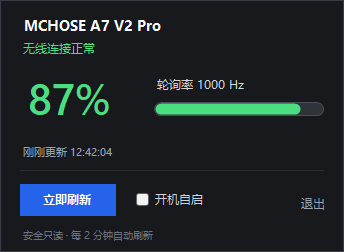

# MouseBatteryDisplay · 鼠标电量任务栏显示

一个给 **MCHOSE A7 V2 Pro** 无线鼠标用的 Windows 任务栏电量小工具。程序常驻系统托盘，图标直接显示电量数字；左键查看详情，右键刷新、设置开机自启或退出。

- 直接读取 2.4G 接收器的 HID 配置通道，**不需要打开 MCHOSE Hub**
- 托盘图标显示百分比，适合 Windows 10 / 11
- 无需管理员权限，使用系统自带 .NET Framework 4.8

> 实测：**A7 V2 Pro · 86% · 使用中 · 1000 Hz**。




## 功能

| 项目 | 内容 |
|---|---|
| 识别设备 | MCHOSE A7 V2 Pro（USB 接收器，VID `3837` / PID `100A`） |
| 安装位置 | `%LOCALAPPDATA%\MouseBatteryDisplay\MouseBatteryDisplay.exe` |
| 开机自启 | `HKCU\Software\Microsoft\Windows\CurrentVersion\Run` 下的 `MouseBatteryDisplay` |
| 开始菜单 | `MouseBatteryDisplay` 快捷方式 |
| 刷新频率 | 每 10 分钟自动读取（鼠标休眠时保留上次电量），也可手动刷新 |

Windows 11 默认会把新图标放进通知区域的 **`^`** 里：点开 `^`，把显示电量的电池图标**拖到任务栏**即可固定。

## 使用方式

- **看电量**：任务栏通知区域的图标会显示两位百分比，例如 `86`。
- **看详情**：左键单击图标，弹出电量面板（设备名、电量、充电状态、轮询率、更新时间）。
- **刷新**：右键菜单 →「刷新电量」，或双击图标。
- **开机自启**：右键菜单 →「开机自启」勾选/取消；详情面板里也有同样选项。
- **退出**：右键菜单 →「退出」。
- **低电量提醒**：电量 ≤ 20% 且未充电时，会弹一次气泡提醒（6 小时内不重复）。

## 电量读取原理

程序只读取鼠标的配置通道，不会修改 DPI、灯光、按键或轮询率设置：

1. 找到 MCHOSE 接收器的 HID 配置接口（Usage Page `0xFF01`）。
2. 发送只读的 `0x06` 设备信息查询；鼠标通过 `0x13` 输入报告推送 `0xE2` 状态包。
3. 从状态包中解析电量、充电状态、轮询率和设备名。
4. 如果鼠标刚从休眠唤醒、第一次查询没有响应，会再重试一次。
5. 定时轮询**不会**为了叫醒鼠标而反复使用兼容命令；只有首次读取、手动刷新，或超过 30 分钟没有成功数据时，才使用 `0x0B 0xAA` 触发一次状态推送。

协议数据经过 `0xFF` 异或编码，和 MCHOSE 官方网页驱动使用的通道一致。

## 环境与限制

- Windows 10 / Windows 11（64 位）。
- 使用系统自带的 **.NET Framework 4.8**，无需安装 Python、Node.js 或额外运行库。
- 目前针对 **MCHOSE A7 V2 Pro 的 2.4G USB 接收器**。如果鼠标切到蓝牙模式，Windows 会识别成另一套设备，本程序会显示「未检测到鼠标」；切回 2.4G 接收器并点「刷新电量」即可。
- 不修改系统设置，不需要管理员权限；开机自启只写入当前用户注册表。

## 构建与安装

在项目目录运行：

```powershell
powershell -NoProfile -ExecutionPolicy Bypass -File .\build.ps1
powershell -NoProfile -ExecutionPolicy Bypass -File .\install.ps1
```

只构建不安装：

```powershell
powershell -NoProfile -ExecutionPolicy Bypass -File .\build.ps1
```

生成文件：`dist\MouseBatteryDisplay.exe`。

## 卸载

```powershell
powershell -NoProfile -ExecutionPolicy Bypass -File .\uninstall.ps1
```

会停止程序、删除开机自启项、开始菜单快捷方式和安装目录。

## 常见问题

**托盘里找不到图标**
点任务栏右侧的 `^` 展开隐藏图标，把电池图标拖到任务栏。也可以在开始菜单搜索 `MouseBatteryDisplay` 重新启动。

**显示「未检测到鼠标」**
确认鼠标的 2.4G USB 接收器插好、鼠标已唤醒；点「刷新电量」。如果鼠标在蓝牙模式，请切回 2.4G。

**电量偶尔不更新**
程序每 10 分钟刷新一次；鼠标休眠时读取会失败并保留上次电量，移动鼠标唤醒后下一次刷新会自动恢复，也可以点「刷新电量」立即读取。

**开机没有自动启动**
右键图标确认「开机自启」已勾选；如果任务管理器「启动应用」里被禁用，请重新启用。注册表项为：

```text
HKCU\Software\Microsoft\Windows\CurrentVersion\Run
MouseBatteryDisplay = "%LOCALAPPDATA%\MouseBatteryDisplay\MouseBatteryDisplay.exe" --startup
```

**日志**
`%LOCALAPPDATA%\MouseBatteryDisplay\app.log`（UTF-8）。

## 文件说明

| 路径 | 说明 |
|---|---|
| [dist/MouseBatteryDisplay.exe](dist/MouseBatteryDisplay.exe) | 可直接运行的最终程序 |
| [src](src) | C# 源码（WinForms 托盘程序 + HID 读取） |
| [build.ps1](build.ps1) | 编译脚本（生成图标并打包 exe） |
| [install.ps1](install.ps1) | 安装到当前用户目录并设置开机自启 |
| [uninstall.ps1](uninstall.ps1) | 卸载 |
| [assets/detail-preview.png](assets/detail-preview.png) | 详情面板预览 |
| [assets/tray-icon-preview.png](assets/tray-icon-preview.png) | 任务栏图标预览 |
